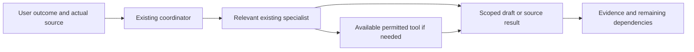

# Source-level workflow

This is a conceptual diagram of the saved instructions, not a running agent team or verified host trace.

The coordinator selects only needed guidance. The shared execution owner preserves scope across supported handoffs; a profile does not launch a worker. Private facts/machine paths stay at the external approved owner and are loaded only when relevant. A tool's installation does not prove authentication or permission for an operation. The conceptual arrows do not imply every task calls a provider or that models can enforce host permissions through prose.

For a requested chain, the active session reports per-item elapsed time, changed work and evidence limits, then continues eligible work. Blocked target/access requirements remain explicit. Source saved, installed, indexed, discovered, authenticated, operation-observed and public release are separate states. No automatic testing, cloud synchronization, training or background service is created by the workflow.

`index.html` is a local documentation-hub source with topic filtering and ordinary links. It uses no external scripts/assets/analytics and leaves all guides visible without JavaScript. The Markdown files remain the source of truth. Browser rendering, keyboard/filter interaction, responsive appearance and Mermaid rendering have not been observed; no preview, build or automated check ran. It is not deployed and does not replace the existing Sites website. Verified demo videos/badges require their actual evidence and remain separate roadmap work.
